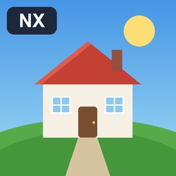

<div align=center>



</div>
<h1 align=center>Sims3-NX</h1>

An unofficial native Nintendo Switch port of the Xbox 360 version of **The Sims 3** (title update 1).

It's not an emulator. The game's PowerPC code (`default.xex` and `Sims3.xex`) is statically recompiled to C++ with
[ReXGlue](https://github.com/rexglue/rexglue-sdk) on the katamari-nx Switch SDK, and the game's Xenos GPU commands
are drawn directly with the Switch GPU's own API, [deko3d](https://github.com/devkitPro/deko3d).

> [!IMPORTANT]
> **No game files are included.** You need your own Xbox 360 copy of The Sims 3, **USA/Europe disc
> (En, Fr, De, Es, It, Nl; media ID 21CDDF46)**, and its **Title Update 1**. Other versions will not run. This project does not host or link to game data.

## What you need

- A Switch running custom firmware (Atmosphère) with the Homebrew Menu.
- Your own extracted Xbox 360 disc: the folder with `default.xex`, `Sims3.xex`, `GameData/`, `UI/`, and so on
  (about 3.8 GB). From a disc image (`.iso`) you can extract it with [extract-xiso](https://github.com/XboxDev/extract-xiso).
- Your own Title Update 1 package for that disc: `454108E2/000B0000/tu00000004_00000000`.
- Python 3 on your computer, for the two small helper scripts in `tools/` (standard library only).
- **An overclock tool is strongly recommended** (see [Performance](#performance)).

## How to install

1. Download `sims3-nx-v0.1.0.zip` from the [Releases](../../releases) page and extract it to the root of your
   SD card. You get `sdmc:/switch/Sims3/sims3.nro` with empty `game/` and `update/` folders.
2. Copy your **whole extracted disc** into `sdmc:/switch/Sims3/game/`, so that `default.xex` is at
   `sdmc:/switch/Sims3/game/default.xex`.
3. Extract the title update into the `update/` folder:

   ```
   python tools/extract_tu.py tu00000004_00000000 update
   ```

   It checks every file and tells you if the package is a different version. Copy the contents of the `update`
   folder it made (`globalpatch.idx`, `Sims3.xexp`, `PrivLoader.xexp` and `GameplayRelease/`) to
   `sdmc:/switch/Sims3/update/`. **Do not copy `default.xexp`**: the script leaves it out on purpose, and the game
   will not start if it is in `update/`.
4. Optional but useful: check your files before copying them to the card.

   ```
   python tools/check_game.py <your game folder> <your update folder>
   ```

5. Start **The Sims 3** from the Homebrew Menu in **title takeover mode** (hold R while launching a real game), not
   from the album applet: the port needs the full memory of a game. A forwarder to `sims3.nro` also works.

The final layout on the SD card:

```
sdmc:/switch/Sims3/
├── sims3.nro
├── fps.txt                 (optional, see below)
├── sims3.toml              (optional, game language, see below)
├── game/                   your extracted disc
│   ├── default.xex
│   ├── Sims3.xex
│   ├── PrivLoader.xex
│   ├── GameData/  GameplayRelease/  UI/  ...
├── update/                 Title Update 1, from extract_tu.py
│   ├── globalpatch.idx  Sims3.xexp  PrivLoader.xexp     (no default.xexp)
│   └── GameplayRelease/
└── logs/                   written by the port (attach the latest one to bug reports)
```

## Performance

The Sims 3 is heavy for the Switch at stock clocks. The port itself never changes clock speeds, so **use an
overclock tool for the best experience**, such as [sys-clk](https://github.com/retronx-team/sys-clk) or one of its
forks, with a profile for the title you launch it from (the game you hold R on, or your forwarder's title ID).

What we tested (with a profile active):

| Setting | Handheld | Docked |
| --- | --- | --- |
| CPU | 1785 MHz | 1785 MHz |
| GPU | 614 MHz | 768 MHz |
| Memory | 1866 MHz | 1866 MHz |

With this, the game runs at about 22–24 fps on average in the neighbourhood and 17–21 fps in busy scenes. Only
use clock speeds your console and your overclock tool support; overclocking is at your own risk.

The frame rate is capped at **30 fps** for smoother pacing. To change the cap, put a file named `fps.txt` next to
`sims3.nro` holding a number: `30` (default), `60`, or `0` for no cap.

## Language

The game uses the language of the (emulated) Xbox 360 system settings, English by default. To change it, create a
text file named `sims3.toml` next to `sims3.nro` with one line, for example for French:

```
user_language = 4
```

| Language | Value |
| --- | --- |
| English (default) | 1 |
| German | 3 |
| French | 4 |
| Spanish | 5 |
| Italian | 6 |

The disc also has Dutch, but the Xbox 360 had no Dutch system language, so this setting cannot select it.

## Status

Working on hardware: the main menu, Create a Sim, the neighbourhood and lots, saving, and long play sessions. Saves made with any controller go to one shared profile.

Known issues:

- Busy scenes drop to the high teens.
- Outfit thumbnails can glitch the first time a category is opened.
- Returning to the main menu from a game can crash.
- Some interface elements (skill bars) show small drawing errors.

### Troubleshooting

- **The game closes right after launch**, and the log says `XEX patch image key doesn't match original XEX!` for
  `default.xexp`: delete `sdmc:/switch/Sims3/update/default.xexp`. If the log names `Sims3.xexp` instead, your disc
  or title update is a different version; run `tools/check_game.py` to see which file differs.

Bug reports are welcome in [Issues](../../issues): include the latest log from `sdmc:/switch/Sims3/logs/`, a
screenshot, and what you were doing.

## Building from source

This is for developers, and not a one-command process yet. The repository holds only the port's own code: no game data, no recompiled game code and
no translated game shaders. To build, you need your own game files plus:

- [ReXGlue](https://github.com/rexglue/rexglue-sdk) and the katamari-nx SDK it is ported to the Switch with, in
  `third_party/`.
- Docker with the `devkitpro/devkita64` image.

Then:

1. Run ReXGlue's code generator on your `default.xex` and `Sims3.xex` with `app/sims3_manifest.toml` (and on the
   executables patched with the title update, see `tools/xexpatch.c`), into `app/generated/`. `tools/docker/Dockerfile.codegen` is the
   environment we use; `tools/post_codegen.py` applies the port's fix-ups.
2. Put the game's shader microcode (captured from the running game) into `work/ucode/`. At build time `tools/xenos2glsl.py` translates it to GLSL
   and `uam` compiles it for deko3d.
3. Build: `docker run --rm -v "$PWD:/nx" -v sims3-build-tu:/b devkitpro/devkita64 sh /nx/tools/docker/build_app.sh full`.

The interesting parts are `app/src/deko3d_graphics.cpp` (the Xenos-to-deko3d renderer: PM4 command processing,
EDRAM and resolves, tiled textures and mip chains, and the shader translation glue) and `sdk_overlay/` (changes
to the SDK's filesystem and kernel layers).

## License

[GPL-3.0](LICENSE), like the katamari-nx SDK it builds on. ReXGlue is under its own license.

The Sims and The Sims 3 are trademarks of Electronic Arts Inc. Sims3-NX is an unofficial fan project, not affiliated
with, endorsed or sponsored by Electronic Arts, Nintendo or Microsoft. You need your own legally obtained copy of the
game.
